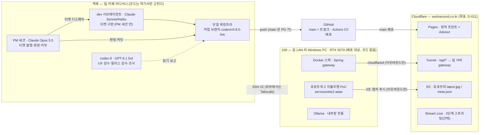

# workaround.co.kr 플랫폼

작은 개인용 서비스를 모아 운영하고, 티켓 기반 자동화와 워커 실행 흐름을 붙일 수 있도록 설계한 개인 플랫폼 모노레포다.

## 지금 어디에 배포돼 있나

공개본은 **GitHub Pages** 에 있다. `main` 에 반영되면 자동 배포된다(Cloudflare 이전 전까지의 임시 공개본, D-011).

- 주소: <https://lim-it-err.github.io/workaround.co.kr-platform/>
- 배포 확인: <https://lim-it-err.github.io/workaround.co.kr-platform/deployment.json> — 배포된 커밋 SHA·빌드 시각

| 화면 | 경로 | 비고 |
|---|---|---|
| 스플래시 → 환승 홀 | [`/`](https://lim-it-err.github.io/workaround.co.kr-platform/) | 노선도에서 모든 화면으로 |
| 여행 노선 | [`/voyage`](https://lim-it-err.github.io/workaround.co.kr-platform/voyage) | 중부유럽 2026 기록·결산 |
| 자취 밥상 | [`/pantry`](https://lim-it-err.github.io/workaround.co.kr-platform/pantry) | 오늘의 한 상·술 페어링 |
| 미스터리 트레인 | [`/sim`](https://lim-it-err.github.io/workaround.co.kr-platform/sim) | 격납고 — 엘리베이터 `/elevator`·심야 택시 `/taxi` |
| 유로트럭 뷰어 | [`/ets2`](https://lim-it-err.github.io/workaround.co.kr-platform/ets2) | 지금은 샘플 화면(R2 연결 전) |
| 운영 노트 | [`/work`](https://lim-it-err.github.io/workaround.co.kr-platform/work) | 개발·운영 구조 공개(D-033), 명령 실행은 보호 |
| Developer Advisor | [`/advisor/`](https://lim-it-err.github.io/workaround.co.kr-platform/advisor/) | 별도 앱 |
| 유로트럭 개발자 | `/ets2/dev` | 보호 구역 — 공개본에서는 잠김 |
| Runtime Board | `/runtime` | 보호 구역 — 공개본에서는 잠김 |
| 블로그·글쓰기 | `/blog`·`/studio` | 운행 중단(D-031) — 환승 홀로 돌아감 |

- 깊은 주소는 Pages 가 HTTP 404 를 돌려준 뒤 `404.html` 셸이 앱을 띄우는 방식이라, 화면은 정상으로 열린다(서버 200 은 TKT-177).

## 목표

이 저장소의 기본 구조는 다음과 같다.

- Vue는 최종 사용자 UI를 담당한다.
- Spring Boot는 API 게이트웨이, 라우터, 티켓 발행기 역할에 집중한다.
- 실제 기능은 `services/` 아래의 독립 서브서비스가 맡는다.
- 워커는 티켓을 구독하고 작업을 수행한다.
- Ollama는 외부 RTX5070 노드에서 내려갈 수 있는 런타임으로 취급한다.

PM 은 Claude(Opus 5.5) 세션이고, 구현은 그 세션 안의 Claude Sonnet/Haiku 서브에이전트, Codex 는 `codex-9` 하나(GPT-6.1 Sol)가 UX 검수·릴리스 감사·조사를 맡는다(D-029·D-030). 어디서 무엇이 도는지는 아래 "개발 구조" 절.

## 저장소 구조

```text
personal-platform/
|- frontend/                  # Vue 최종 사용자 화면
|- gateway/                   # Spring Boot API Gateway / Router / Ticket Issuer
|- services/                  # 언어 독립 서브서비스
|  |- elevator-service/       # 후속 서비스 계약 후보
|  |- public-site/            # 공개 소개 페이지 정적 서비스
|  |- sample-python-service/  # 레거시 예시 서비스
|  `- sample-spring-service/  # 예시 서비스
|- workers/                   # 티켓 subscriber / 작업 실행자 / 오케스트레이터 보조 루프
|  |- ion2-worker/
|  `- orchestrator-heartbeat/
|- llm/
|  `- ollama/                 # 외부 RTX5070 Ollama 연결 정책
|- infra/
|  |- nginx/
|  |- public-site/
|  `- redis/
|- design/                    # UI/UX 기준선, 감사 기록, 오케스트레이터-디자이너 협업 문서
|- docs/                      # 구조, 운영 정책, 릴리즈, 티켓, 히스토리
`- README.md
```

## 핵심 흐름

```text
사용자 -> Vue 프런트엔드 -> Spring Gateway -> 각 서브서비스
Codex -> Spring Gateway Ticket API -> Redis Streams -> 워커
워커 -> 필요 시 외부 RTX5070 Ollama 호출
```

Spring은 무거운 비즈니스 로직을 쌓는 곳이 아니라, 게이트웨이와 라우팅, 티켓 조정, 헬스 집계 계층으로 유지한다.

## 개발 구조 — 어디서 무엇이 도는가

코드는 GitHub 한 곳에만 있고, 개발은 맥북에서(집이든 카페든) 하고, 실행은 세 곳(맥북 · 집의 Windows PC `.100` · Cloudflare)으로 나뉜다. 결정 근거는 [docs/decisions.md](docs/decisions.md) D-011(호스팅)·D-025/D-028(유로트럭)·D-029(역할).



### 세 실행 장소

- **맥북** — 개발·판정·커밋이 전부 여기서 일어난다. 워킹트리는 하나(`codex/v0.8.0-live`)이고, PM 세션(Claude Opus 5.5)이 티켓을 내고 판정·커밋하며, 구현은 PM 세션이 띄우는 dev 서브에이전트(Claude Sonnet 기본, 단순 건 Haiku)가 티켓 단위로 한다. Codex 는 `codex-9` 하나(GPT-6.1 Sol)로, 코드를 고치지 않고 UX 실화면 검수·릴리스 감사·조사 보고만 한다. 역할표는 [AGENTS.md](AGENTS.md). 카페에서는 인터넷만 있으면 GitHub·공개본·Cloudflare 작업이 되고, `.100` 은 LAN 밖이라 SSH 가 Tailscale 을 거쳐야 한다. 네트워크가 없을 때는 아래 "비행기에서" 절.
- **`.100` (Windows · RTX 5070)** — 유로트럭 2(ETS2)와 자율주행 PoC(`services/ets2-adas/`)가 돈다. 코드는 두지 않는다: 맥에서 SSH 로 동기화·기동·중지·로그 수집을 하는 **배포 대상**이다(D-028). 화면 캡처·게임 입력은 로그온 세션이 필요해 작업 스케줄러 태스크로 띄운다. PoC 는 2초마다 캡처를 R2 로 밀어 올리기만 하고(아웃바운드), 외부에서 들어오는 포트는 없다. Ollama 는 gateway 뒤 내부망에만 있다.
- **Cloudflare (목표 호스팅, `workaround.co.kr`)** — 정적 프런트는 Pages, 동적 `/api/*` 는 Tunnel 로 집 서버 gateway 에 연결, 유로트럭 프레임은 R2 공개 버킷, 실시간 스트리밍이 필요해지면 Stream Live 또는 Tunnel 뒤 MediaMTX(2단계). 집 회선이 죽어도 정적 콘텐츠는 살아 있다. 전환 티켓은 TKT-085(도메인·Tunnel)·TKT-167(R2 퍼블리셔). **지금은 GitHub Pages 가 임시 공개본**이다(아래 절).

### 코드 흐름

```text
dev 서브에이전트 구현 → need_review → PM 판정(빌드·단위·E2E·실화면) → PM 커밋 → codex/v0.8.0-live push
→ 배치 병합(--no-ff) → PO 가 main push → Actions 가 Pages 배포 → PM 라이브 스모크
```

버전 태그 전에는 Codex 감사(`reports/advisory/`)가 한 번 더 본다. 비밀값(R2 키·토큰·프로필 경로)은 `.100` 의 `.env` 에만 두고 저장소·문서·채팅에 적지 않는다.

## 현재 릴리즈 기준

- `v0.1.0`: 첫 실행 가능한 플랫폼 골격
- `v0.1.2`: `v0.1.1` 빌드 툴 정리 이후 런타임 정렬 단계
- `v0.1.3`: 샘플 서비스 정리와 후속 서비스 계약 준비
- `v0.1.4`: 샘플 Python 잔여 기본값 같은 릴리스 전 정밀 정리
- `v0.2.0`: `http://localhost:7000` 에서 볼 수 있는 통합 결과물
- `v0.2.1`: 테스트 코드 확장과 커버리지 측정
- `infra`: 워커, Docker, GPU 런타임, Ollama 서빙 기반 작업

세부 목표는 [docs/releases.md](docs/releases.md) 에 정리한다.
버전 진행 상한은 [docs/version-policy.md](docs/version-policy.md) 를 따른다.
1차 공개 웹사이트 목표는 [docs/roadmap.md](docs/roadmap.md) 에 정리한다.

## GitHub Pages 여행 우선 공개

- 공개 주소: <https://lim-it-err.github.io/workaround.co.kr-platform/>
- 트렁크는 `main`(2026-09-28 승격, v0.7.0). `main`에 반영되면 `.github/workflows/deploy-github-pages.yml`이 `frontend`와 Advisor를 Pages base로 빌드해 자동 배포한다.
- 수동 배포는 GitHub의 **Actions → Deploy GitHub Pages → Run workflow**에서 `main`을 선택한다.
- Line V는 첫 화면의 `Line V / Voyage`에서 준비·일일 안내·도시 기록으로 들어간다.
- 블로그 본선(공개 아카이브·글 상세·Writing Studio)은 **운행 중단**이다(D-031, 2026-10-25). 코드는 보존하고 홈·주소에서만 내렸다.
- 여행 메모는 현재 같은 브라우저의 `localStorage`에만 남는다. 다른 기기와 동기화되지 않고 브라우저 데이터 삭제 시 복구되지 않는다.
- Pages 배포 SHA와 빌드 시각은 배포 산출물의 `deployment.json`과 Actions 실행 요약에서 확인한다.

## 비행기에서(오프라인) 홈페이지 켜기

GitHub Pages 공개본은 네트워크가 있어야 열리고 오프라인 캐시(서비스 워커)가 없다. 기내에서는 **맥북에서 로컬로 빌드해 연다.** 폰 단독으로는 기내 Wi-Fi 없이 열 수 없다. 아래 절차는 2026-09-17 에 macOS · Node 20 에서 직접 돌려 확인했다.

### 탑승 전 — 네트워크가 있을 때 한 번

1. 최신 받기: `git pull`
2. 의존성 확인(`node_modules` 가 이미 있으면 생략): `npm --prefix frontend ci` 와 `npm --prefix services/advisor/frontend ci`
3. 아래 "기내에서" 명령을 미리 한 번 돌려 화면이 뜨는지 본다. 빌드까지 해 두면 기내에서는 마지막 `preview` 한 줄이면 된다.
4. 폰에 적어 둔 여행 기록을 맥북에서도 보려면: 폰의 여행 화면에서 `내 기록 백업` → 내려받은 JSON 을 AirDrop 으로 맥북에 → 로컬 화면에서 `백업 복원`. 브라우저 저장소는 주소(origin)별이라 공개본에서 쓴 기록이 `localhost` 에 자동으로 보이지 않는다.

### 기내에서 — 네트워크 불필요

저장소 루트(`workaround.co.kr-platform/`)에서:

```bash
npm --prefix frontend run build -- --base=/workaround.co.kr-platform/
npm --prefix services/advisor/frontend run build -- --base=/workaround.co.kr-platform/advisor/
node infra/public-site/prepare-github-pages.mjs --dist frontend/dist --advisor-dist services/advisor/frontend/dist --base /workaround.co.kr-platform/ --sha local-offline
npm --prefix frontend run preview -- --base=/workaround.co.kr-platform/ --port 4180
```

브라우저에서 <http://localhost:4180/workaround.co.kr-platform/> 을 연다. 끌 때는 터미널에서 `Ctrl+C`.

- 환승 홀·여행(`/voyage`)·자취 밥상(`/pantry`)·미스터리 트레인(`/sim`, 심야 택시)은 직접 주소와 새로고침 모두 동작한다. 블로그·글쓰기는 운행 중단(D-031).
- Developer Advisor 는 <http://localhost:4180/workaround.co.kr-platform/advisor/> 로 들어간다. 이 방식에서는 Advisor 안쪽 주소(`/advisor/today` 등)에서 **새로고침하면 메인 홈이 뜬다** — 다시 `/advisor/` 로 들어가면 된다(공개본은 `404.html` 이 처리하지만 `vite preview` 는 그렇지 않다). 새로고침이 자유로워야 하면 Advisor 만 따로 띄운다: `npm --prefix services/advisor/frontend run dev` → <http://localhost:5173>.
- 이 빌드는 공개본과 같은 **정적 모드**다(base 경로가 `/` 가 아니면 정적 모드). Work·Runtime·엘리베이터는 흐림 + `준비 중` 으로 보이는 것이 정상이다.
- 가장 빠른 대안(여행 등 메인 화면만, Advisor 제외): `VITE_STATIC_MODE=true npm --prefix frontend run dev` → <http://localhost:7000>. 빌드 없이 바로 뜬다.
- 기내에서 적은 여행 메모는 **그 브라우저의 `localStorage` 에만** 남는다. 착륙 후 `내 기록 백업`(여행)으로 JSON 을 내려받아 둔다. 데이터 파일 반영 절차는 [`docs/voyage-record-import.md`](docs/voyage-record-import.md).

## 테스트 / 커버리지

- Node/npm 기준선 점검: `powershell -ExecutionPolicy Bypass -File .\tools\check-node-toolchain.ps1`
- 프런트엔드 의존성 설치: `powershell -ExecutionPolicy Bypass -File .\tools\run-frontend-install.ps1`
- 프런트엔드 빌드: `powershell -ExecutionPolicy Bypass -File .\tools\run-frontend-build.ps1`
- 프런트엔드 개발 서버: `powershell -ExecutionPolicy Bypass -File .\tools\run-frontend-dev.ps1`
- 통합 프리뷰 한 번에 기동: `powershell -ExecutionPolicy Bypass -File .\tools\start-local-preview.ps1`
- 통합 프리뷰 중지: `powershell -ExecutionPolicy Bypass -File .\tools\stop-local-preview.ps1`
- 게이트웨이 테스트 + JaCoCo 리포트: `powershell -ExecutionPolicy Bypass -File .\tools\run-gateway-tests.ps1`
- GitHub Actions CI: [`.github/workflows/ci.yml`](.github/workflows/ci.yml)
- 로컬 게이트웨이 커버리지 HTML 리포트: `gateway/target/site/jacoco/index.html`
- GitHub Actions 커버리지 산출물: `gateway-jacoco-report` artifact

`tools/start-local-preview.ps1` 는 `frontend:7000`, `gateway:8080`, `elevator-service:8003` 를 함께 올린다. 엘리베이터 서비스는 로컬 Python 실행을 먼저 시도하고, 실패하면 Docker container fallback 으로 `8003` 을 복구한다.

## 로컬 Node / npm 기준

- 프런트엔드의 정식 로컬 기준선은 Windows x64 `Node.js 22 LTS` 와 함께 설치되는 `npm`, `npx` 가 PATH 에 잡힌 상태다.
- 표준 실행 흐름은 `frontend/` 에서 `npm install`, `npm run dev -- --host 0.0.0.0 --port 7000`, `npm run build` 순서를 따른다.
- `tools/run-frontend-dev.ps1`, `tools/run-frontend-build.ps1` 는 PATH 에 `npm` 이 있으면 위 표준 흐름을 그대로 사용한다.
- PATH 에 `npm` 이 없는 Codex 작업 세션에서는 같은 스크립트가 저장소 안 `tools/local-node/node.exe` 와 `frontend/node_modules/vite/bin/vite.js` 로 fallback 실행을 시도한다.
- 이 fallback 경로는 이미 `frontend/node_modules/` 가 준비된 세션의 임시 재현용이며, 새로운 의존성 설치나 lockfile 재생성의 대체 기준으로 쓰지 않는다.

## 문서 읽기 규칙

작업 전에는 `AGENTS.md`, 관련 `docs/*`, 관련 `docs/history/*` 를 먼저 읽는다. UI/UX 작업이라면 `design/*` 와 최신 `design/orchestrator_review/*` 도 함께 읽는다. 구현과 문서가 어긋나면 작업을 끝내기 전에 둘을 다시 맞춘다.

## 문서 공개 규칙

- `docs/` 아래 문서는 기본적으로 로컬 운영 문서다.
- `docs/releases.md`만 공개 기준 문서로 사용할 수 있다.
- 티켓 문서와 히스토리 문서는 GitHub 공개 대상으로 보지 않는다.
